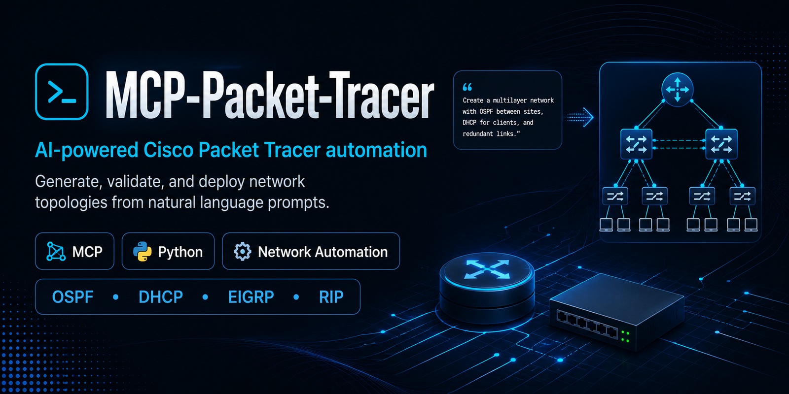
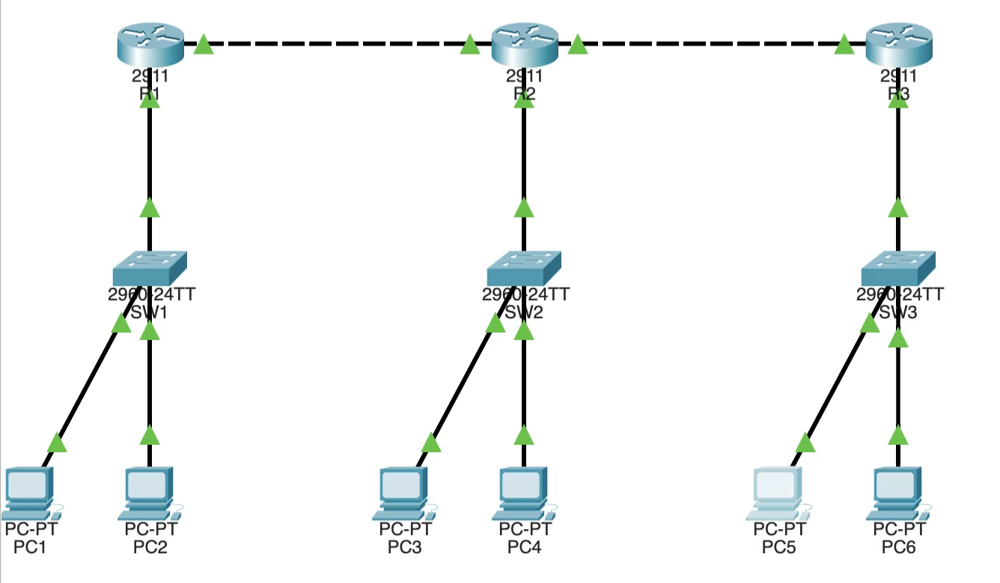

<div align="center">



**Tell your AI _"build a network with 3 routers, OSPF and DHCP"_ — it plans, validates, generates and deploys the topology straight into Cisco Packet Tracer, then reads the result back.**

[](https://python.org)
[](https://modelcontextprotocol.io)
[](https://docs.pydantic.dev)
[](LICENSE)
[](https://github.com/Mats2208/MCP-Packet-Tracer)

<br/>

<table>
<tr>
<td align="center"><strong>79 MCP tools</strong></td>
<td align="center"><strong>6 resources</strong></td>
<td align="center"><strong>3 prompts</strong></td>
<td align="center"><strong>74 device models</strong></td>
<td align="center"><strong>150 modules</strong></td>
<td align="center"><strong>15 cable types</strong></td>
<td align="center"><strong>9 templates</strong></td>
</tr>
</table>

</div>

---

## About this repository

This is a **copy of [Mats2208/MCP-Packet-Tracer](https://github.com/Mats2208/MCP-Packet-Tracer)**, published here as a single snapshot under a different account. The project, its design and its code come from **Mateo ([@Mats2208](https://github.com/Mats2208))** and the upstream contributors, and are released under the MIT License — that copyright notice is kept intact in [`LICENSE`](LICENSE).

The upstream repository is the canonical source: releases, issue tracker, documentation site and the compiled Packet Tracer extension live there. This copy is self-contained for reading and for running from source; it does **not** publish a PyPI package and does **not** ship a compiled `.pts` extension (see [Live deploy](#live-deploy) for how to get one).

---

## Contents

- [What it does](#what-it-does)
- [Requirements](#requirements)
- [Installation](#installation)
- [Connect an MCP client](#connect-an-mcp-client)
- [Quick start](#quick-start)
- [The build pipeline](#the-build-pipeline)
- [Live deploy](#live-deploy)
- [Device panel and UI mode](#device-panel-and-ui-mode)
- [Tool reference](#tool-reference)
- [MCP resources and prompts](#mcp-resources-and-prompts)
- [Networking behavior](#networking-behavior)
- [Device catalog, ports and cabling](#device-catalog-ports-and-cabling)
- [Project files on disk](#project-files-on-disk)
- [Architecture](#architecture)
- [Development and testing](#development-and-testing)
- [Troubleshooting](#troubleshooting)
- [Security model](#security-model)
- [FAQ](#faq)
- [Credits and provenance](#credits-and-provenance)
- [License](#license)

---

## What it does

A **Model Context Protocol (MCP) server for Cisco Packet Tracer**. Any MCP-capable client — Claude Code, Claude Desktop, Cursor, VS Code with Copilot, Codex — can plan a topology, validate it, turn it into IOS configuration and drive a running copy of Packet Tracer through it.

The unusual part is not that it generates configs: it is that it **closes the loop**. It can place the devices in the real application, configure them through Packet Tracer's own API, then read the device back and tell you what actually happened — including the cases where the model claims something that is not there.

| | Capability | What it covers |
|---|---|---|
| **Planning** | Structured → topology | Templates, router/switch/host counts, WAN, VLANs, dual stack, wireless laptops |
| **Addressing** | Automatic IPv4 plan | One `/24` per LAN (from `192.168.0.0/16`), one `/30` per router link (from `10.0.0.0/16`), gateway at `.1` |
| **DHCP** | Routers and servers | Router pools via `dhcp=True`; dedicated Server-PT pools with `pt_configure_dhcp_server` |
| **Routing** | Static and dynamic | Static, floating static, OSPF, EIGRP, RIP, or none — full IOS generation |
| **Switching** | VLANs and trunks | Access ports, 802.1Q trunks, router-on-a-stick subinterfaces, per-VLAN DHCP, STP, port-security |
| **Security config** | Hardening and policy | SSH, local users, enable secret, banners, ACLs (standard/extended/named), NAT/PAT |
| **IPv6** | Dual stack | Routers configured via CLI, hosts via SLAAC |
| **Wireless** | Laptops and APs | NIC swap to wireless, automatic association with an Access Point |
| **Validation** | Typed errors + fixer | Wrong cables, missing ports, incompatible modules, model upgrades |
| **Live deploy** | Two bridge channels | HTTP while the extension window is open, file bridge while it is closed |
| **Verification** | Plan vs. reality | `pt_diff`, `pt_health_check`, a real `ping` from a device |
| **Inspection** | Read the device, not the plan | Per-port state, VLAN database, security grade, power control |
| **Packet tracing** | Why, not just whether | Simulation stepping plus Packet Tracer's own per-OSI-layer decision log |
| **Telemetry** | NetFlow and QoS | Configure NetFlow and read it back; read class-maps and policy-maps |
| **Device panel** | Every tab of a device | IOS CLI, Command Prompt, Terminal, IP Configuration, browser, email, server services |
| **UI mode** | Watch it happen | Open the real device windows and capture PNGs — headless by default |
| **Backup** | Real device state | Startup-config, serial, config-register, uptime, project metadata |
| **Export** | Files you can keep | Script, per-device CLI configs and `plan.json` under `projects/<name>/` |

<p align="center">
  
</p>
<p align="center"><sub>A 3-router linear topology with OSPF, DHCP and six PCs, planned and deployed through MCP tools</sub></p>

---

## Requirements

| | Requirement |
|---|---|
| **Python** | 3.11, 3.12 or 3.13 |
| **MCP client** | Anything that speaks MCP over stdio or streamable HTTP |
| **Packet Tracer** | 9.0.x (verified), only for the live features — planning, validation, config generation and export work fully offline |
| **Operating system** | Windows, macOS or Linux. The clipboard deploy and **UI mode** are Windows-only; the live bridge itself is not OS-bound |
| **Extension** | Version **V5 or newer** for the authenticated bridge (see [Live deploy](#live-deploy)) |

---

## Installation

### From source

This snapshot is not published to PyPI. Install it from the checkout:

```bash
git clone https://github.com/aymenmerabta5/MCP-Packet-Tracer.git
cd MCP-Packet-Tracer
python -m venv .venv
```

Activate the environment, then install:

```powershell
# Windows PowerShell
.\.venv\Scripts\Activate.ps1
pip install -e .
```

```bash
# Linux / macOS
source .venv/bin/activate
pip install -e .
```

### Optional: UI mode

UI mode opens and captures the real device windows using Windows UI Automation. It needs an extra dependency and only works on Windows:

```powershell
pip install -e ".[ui]"
```

Headless mode — everything else — works on every platform without it.

### Verify the install

```bash
python -m packet_tracer_mcp --stdio
```

The process waits for MCP traffic on stdin, which is what success looks like; `Ctrl+C` to stop. The package also installs a `pt-mcp` console script:

```bash
pt-mcp --stdio     # stdio transport, for MCP clients
pt-mcp             # streamable HTTP on http://127.0.0.1:39000/mcp
```

> **Two different ports, on purpose.** `39000` is the MCP server your client talks to. `54321` is the Packet Tracer bridge the server talks to. `pt_bridge_status` reports the second one.

---

## Connect an MCP client

### Claude Code

```bash
claude mcp add --scope user --transport stdio packet-tracer -- python -m packet_tracer_mcp --stdio
```

PowerShell needs the `--` separator quoted, otherwise PowerShell swallows it and Claude aborts with `error: unknown option '-m'`:

```powershell
claude mcp add --scope user --transport stdio packet-tracer "--" python -m packet_tracer_mcp --stdio
```

Check it with `claude mcp list` — you want `packet-tracer … ✓ Connected`.

If `python` is not the interpreter you installed into, use its absolute path. A virtual environment is usually the safer choice:

```bash
claude mcp add --scope user --transport stdio packet-tracer -- /path/to/.venv/bin/python -m packet_tracer_mcp --stdio
```

### Claude Desktop, Cursor and other `mcpServers` clients

```json
{
  "mcpServers": {
    "packet-tracer": {
      "command": "python",
      "args": ["-m", "packet_tracer_mcp", "--stdio"]
    }
  }
}
```

- **Claude Desktop:** `claude_desktop_config.json` (`%APPDATA%\Claude\` on Windows, `~/Library/Application Support/Claude/` on macOS).
- **Cursor:** `~/.cursor/mcp.json` or the project's `.cursor/mcp.json`.

### VS Code

`.vscode/mcp.json` uses `servers` and an explicit transport type:

```json
{
  "servers": {
    "packet-tracer": {
      "type": "stdio",
      "command": "python",
      "args": ["-m", "packet_tracer_mcp", "--stdio"]
    }
  }
}
```

### Codex

```bash
codex mcp add packet-tracer -- python -m packet_tracer_mcp --stdio
```

### Streamable HTTP

Clients that support remote MCP servers can skip stdio. Start the server without `--stdio` and point the client at the endpoint:

```json
{
  "mcpServers": {
    "packet-tracer": {
      "type": "http",
      "url": "http://127.0.0.1:39000/mcp"
    }
  }
}
```

The HTTP transport binds to `127.0.0.1` only. Do not expose port `39000` to a network.

### Agent skill (recommended)

The repository ships a companion **Agent Skill** in [`skill/`](skill/SKILL.md) that teaches a model the exact tool catalog, the discover → plan → validate → deploy workflow and the real Script Engine API, so it stops inventing model, port and method names.

```bash
# Linux / macOS / Git Bash
mkdir -p ~/.claude/skills/packet-tracer && cp -r skill/. ~/.claude/skills/packet-tracer/
```

```powershell
# Windows PowerShell
New-Item -ItemType Directory -Force "$HOME\.claude\skills\packet-tracer" | Out-Null
Copy-Item -Recurse -Force skill\* "$HOME\.claude\skills\packet-tracer\"
```

Then run `/reload-skills` (or restart the client) and confirm with `/skills`.

---

## Quick start

Talk to the client in plain language:

> *"Build a branch office with a head office, three branches, OSPF and DHCP."*

> *"Make a single LAN with one router, one switch and ten PCs, then add a note with the subnet on the canvas."*

> *"Read the topology that is open in Packet Tracer and tell me which interfaces are down."*

> *"Configure VLANs 10 and 20 on SW1 with a trunk to R1 and inter-VLAN routing."*

A build usually looks like this under the hood:

```text
pt_list_devices                 # real models and ports
pt_plan_topology(...)           # structured plan, no PT needed
pt_validate_plan(plan_json)     # typed errors and warnings
pt_fix_plan(plan_json)          # optional: repair what validation found
pt_live_deploy(plan_json)       # devices, links, then IOS configs
pt_health_check()               # what is actually up
```

or, in one call, `pt_full_build`, which runs plan → validate → generate → explain → deploy.

**Nothing is guessed.** The server instructions require the model to call `pt_list_devices`, `pt_get_device_details` and `pt_list_modules` before it writes a plan, because Packet Tracer answers a wrong API call with a bare `Invalid arguments for IPC call "X"` and no explanation. The catalog is the contract.

---

## The build pipeline

| Stage | Tools | Needs Packet Tracer? |
|---|---|---|
| **Discover** | `pt_list_devices`, `pt_get_device_details`, `pt_list_modules`, `pt_list_templates`, `pt_list_projects` | No |
| **Plan** | `pt_plan_topology`, `pt_estimate_plan` | No |
| **Check** | `pt_validate_plan`, `pt_fix_plan`, `pt_explain_plan` | No |
| **Generate** | `pt_generate_script`, `pt_generate_configs`, `pt_export` | No |
| **Deploy** | `pt_live_deploy`, `pt_full_build`, `pt_deploy` | Yes for live, no for clipboard export |
| **Verify** | `pt_diff`, `pt_health_check`, `pt_verify_connectivity` | Yes |
| **Inspect** | `pt_query_topology`, `pt_export_topology`, `pt_inspect_ports`, `pt_read_vlans`, `pt_audit_security` | Yes |

The offline half is deterministic code, not a prompt: the same parameters produce the same plan, the same IPs and the same CLI. You can review a whole configuration before Packet Tracer is even open.

### `pt_full_build` in one example

```json
{
  "routers": 3,
  "routing": "ospf",
  "has_wan": true,
  "dhcp": true,
  "pcs_per_lan": 4,
  "switches_per_router": 1,
  "template": "branch_office"
}
```

That produces three routers, three LANs, a WAN cloud, OSPF adjacencies, DHCP pools per LAN and the matching IOS configuration — then deploys it if the bridge is connected.

---

## Live deploy

Live deploy streams the plan into a **running** Packet Tracer. It needs one piece the Python package cannot provide: the **MCP Control Center** extension, which runs inside Packet Tracer's Script Engine.

### 1. Get the extension

The compiled `.pts` is a build artifact and is **not** in this repository. Either:

- download the prebuilt **V5.x** module from the [upstream Releases](https://github.com/Mats2208/MCP-Packet-Tracer/releases/latest) — same bridge protocol, same source tree; or
- compile it yourself from [`EXTENSION/`](EXTENSION/README.md). That needs the PTBuilder reference files, which are deliberately not redistributed here.

### 2. Install it in Packet Tracer

1. Open Packet Tracer.
2. **Extensions → Scripting → Configure PT Script Modules → Add…**
3. Select the `.pts` file.
4. Restart Packet Tracer, then open **Extensions → MCP BUILDER**.

The window autoconnects to the bridge; there is no snippet to paste. The module must be **V5 or newer**: the bridge authenticates every request with a per-machine token, and older builds cannot read it.

### 3. Check the connection

Ask the client to call `pt_bridge_status`. You want a channel reported as connected, not "no bridge".

### Two channels, one extension

| Channel | Lives in | Runs when | How it works |
|---|---|---|---|
| **HTTP** | the extension's webview (`interface.js`) | the MCP BUILDER window is open | polls `127.0.0.1:54321` and executes commands |
| **File bridge** | the Script Engine (`main.js`) | Packet Tracer is open, even with the window closed | reads a mailbox under `%LOCALAPPDATA%\packet-tracer-mcp\bridge\` |

The server picks a channel per command. Closing the MCP BUILDER window does not stop a build; closing Packet Tracer does.

### What the bridge can and cannot do

- It executes inside Packet Tracer with Packet Tracer's own privileges. That is the point — and the reason the bridge is authenticated and loopback-only.
- PT's `executeCode()` strips newlines from code **pasted** into the Builder Code Editor. Generated scripts are single-line for that reason.
- An uncaught error inside `runCode` opens a modal that freezes the webview and stops polling. Fire-and-forget commands are wrapped in `try{…}catch{}`; if the UI ever stops responding, close the modal in Packet Tracer.

### Manual deploy, without the bridge

`pt_deploy` is the fallback. It copies the topology script to the Windows clipboard, writes `projects/<name>/` and returns step-by-step instructions for pasting it into Packet Tracer by hand. On Linux and macOS the clipboard step is skipped and only the files are written.

---

## Device panel and UI mode

Once a topology is live, the agent can work inside each device the way a student would: type in a router's **CLI** tab, run `ping` and `ipconfig` in a PC's **Command Prompt**, set **IP Configuration**, browse with the **Web Browser**, or configure a server's **DHCP / DNS / HTTP / FTP / EMAIL** services. Everything goes through Packet Tracer's own API, so what it types appears in the real tab and you can watch or take over.

It is **headless by default**: nothing opens on screen. Switch modes and every panel tool also opens the device window on the matching tab:

```text
pt_ui_mode(mode="ui")        # show what the tools do
pt_ui_mode(mode="headless")  # back to API-only
pt_ui_mode(mode="status")    # which mode am I in?
```

The mode is saved next to the bridge token, so it survives a restart. Precedence:

```text
show=True/False on the call  >  saved file  >  PT_MCP_UI_MODE  >  headless
```

Each panel tool also accepts `show=True/False` for a single call and `capture=True` to save a PNG when it finishes. Claude Code users get `/mcp__packet-tracer__ui_on`, `ui_off` and `ui_status`.

**UI mode requirements and limits**

- Windows, plus the `[ui]` extra (`comtypes`). It drives windows with UI Automation and posts a click to the canvas — your real mouse and keyboard are never used.
- Packet Tracer 9.0.1 does not expose everything to an extension. PC wireless profiles, the Text Editor and the email service's *Domain Name* / individual host-firewall rules have no usable API; open the window with `pt_ui_open` and set those by hand.

---

## Tool reference

**79 tools**, grouped by what they are for. Tools marked as reading or changing Packet Tracer need the [bridge](#live-deploy); the rest are offline.

The argument list shows **required** arguments only — every other parameter has a default and is visible in your client's tool schema. Plans travel as a JSON string (`plan_json`), which is what `pt_plan_topology` returns and what the deploy and validation tools expect.

### Catalog and discovery

| Tool | What it does |
|------|--------------|
| `pt_list_devices` | Every model you can place, with its exact port names and ~100 aliases. Call this before planning. |
| `pt_get_device_details(model_name)` | Ports, category and slot layout for one model (name or alias). Use it instead of guessing an interface. |
| `pt_list_templates` | The 9 topology templates, their router ranges and default routing. |
| `pt_list_modules` | Expansion modules, optionally filtered by router model or category. Call it before installing anything. |
| `pt_list_projects` | Projects already exported under `projects/`. |

### Planning

| Tool | What it does |
|------|--------------|
| `pt_plan_topology` | Build a complete `TopologyPlan`: devices, links, IPs, routing, DHCP, VLANs, IPv6. Fully offline. |
| `pt_estimate_plan` | Quick estimate (dry-run) without generating a full plan. Shows how many devices, links and subnets will be created. |
| `pt_validate_plan(plan_json)` | Validate a plan and return typed errors and warnings. Nothing touches Packet Tracer. |
| `pt_fix_plan(plan_json)` | Repair a plan automatically: cable types, port reassignment, router upgrades when a model lacks ports. |
| `pt_explain_plan(plan_json)` | Explain the plan's choices in natural language: models, addressing, routing, why a cable was picked. |

### Generation and export

| Tool | What it does |
|------|--------------|
| `pt_generate_script(plan_json)` | Emit the PTBuilder JavaScript that creates the topology (`lwAddDevice`, `lwAddLink`, …). |
| `pt_generate_configs(plan_json)` | Emit the IOS CLI configuration for every router and switch, plus host settings. |
| `pt_export(plan_json)` | Write `topology.js`, `full_build.js`, per-device `*_config.txt` and `plan.json` under `projects/<name>/`. |
| `pt_load_project(project_name)` | Load `plan.json` from an exported project and return the plan. |
| `pt_full_build` | One-shot pipeline: plan → validate → generate → explain → deploy. The usual entry point. |
| `pt_deploy(plan_json)` | Clipboard + exported files + step-by-step manual instructions. Works without the bridge on Windows; exports only elsewhere. |

### Live bridge

These tools talk to a running Packet Tracer. Without a connected bridge they return an error instead of pretending.

| Tool | What it does |
|------|--------------|
| `pt_bridge_status` | Which bridge channel is connected, plus the counters of rejected requests. |
| `pt_live_deploy(plan_json)` | Stream a plan into a running Packet Tracer: devices, links, then IOS configs. Reconciles what already exists. |
| `pt_query_topology` | Every device currently in PT, with model, ports and per-port IPs. |
| `pt_export_topology` | Full snapshot of the live canvas: positions, interfaces with IPs, links and cable types. |
| `pt_save_project(filename)` | Save the running topology as a real `.pkt` file, not just the plan JSON. |
| `pt_open_project(path)` | Open a `.pkt` in Packet Tracer. Replaces the current topology. |
| `pt_send_raw(js_code)` | Run arbitrary JavaScript in PT's Script Engine. `wait_result=True` injects `reportResult` and waits for it. |

### Live editing

| Tool | What it does |
|------|--------------|
| `pt_add_device(name, model)` | Add a single device to Packet Tracer with validation. Checks: name not empty, model exists in catalog, no duplicate name. |
| `pt_add_link(device1, port1, device2, port2)` | Link two devices, validating that both exist, both ports exist, the ports are free and the cable is valid. The cable is inferred if omitted. |
| `pt_delete_link(device_name, interface_name)` | Delete the link connected to a specific interface on a device in PT. |
| `pt_delete_device(device_name)` | Delete a device and verify it is gone. |
| `pt_rename_device(old_name, new_name)` | Rename a device in the active Packet Tracer topology. |
| `pt_move_device(device_name, x, y)` | Move a device to new coordinates on the Packet Tracer canvas. |
| `pt_set_port(device, interface)` | Low-level port attributes on a live device: bandwidth, duplex, description, MAC, power. |
| `pt_add_module(device_name, slot, module_name)` | Install one module in a slot, with a power-cycle and a read-back of the new ports. |
| `pt_remove_module(device, slot)` | Remove the module in a slot, with a power-cycle, and report which ports disappeared. |
| `pt_install_modules_batch(modules)` | Install several modules in a single power-cycle — preferred whenever you need more than one. |

### Device panel: CLI, Desktop and Services

Everything a student does inside a device window, through PT's own API. Nothing takes over your mouse or keyboard.

| Tool | What it does |
|------|--------------|
| `pt_cli(device, commands)` | Type IOS commands into a router/switch console, one at a time, waiting for each prompt: `enable`, `conf t`, `show ip route`, `copy run start`… |
| `pt_host_command(device, command)` | Run a command in a PC's Command Prompt: `ping`, `ipconfig /all`, `tracert`, `arp -a`, `nslookup`, `telnet`, `ssh`. |
| `pt_terminal(device, commands)` | Type on a router's console through the PC that is console-cabled to it, as from the Desktop Terminal app. |
| `pt_host_ip_config(device)` | Set a host's static IP, mask, gateway and DNS, or request DHCP and wait for the lease. Also IPv6. |
| `pt_host_firewall(device)` | A host's Desktop > Firewall / IPv6 Firewall: switches the inbound firewall on or off (True/False; None = leave alone). Individual rules have no API in PT; edit them in the window (pt_ui_open(host, app="firewall")). |
| `pt_web_browser(device, url)` | A host's Desktop > Web Browser: opens a URL (http://IP, http://name with DNS, https://...) and returns the text of the page it received. |
| `pt_email_client(device)` | Configure an email account, send a message, or read the POP3 inbox. |
| `pt_server_dhcp(device)` | A Server-PT's Services > DHCP: creates or edits a pool and switches it on. |
| `pt_server_dns(device)` | A Server-PT's Services > DNS: adds/removes records and switches the service on. |
| `pt_server_http(device)` | A Server-PT's Services > HTTP: switches HTTP/HTTPS and edits pages. |
| `pt_server_service(device, service)` | A Server-PT's Services > TFTP / FTP / SYSLOG / EMAIL. |
| `pt_read_device_panel(device)` | Reads what a device's tabs show, in one go (read-only): model, power, whether it is a host, DHCP, per port IP/mask/MAC/state/IPv6/firewall/ bandwidth, and on servers which services (DHCP, DNS, HTTP, TFTP, FTP, SYSLOG, EMAIL, NTP) are on. |

### UI mode

Headless by default. In UI mode every panel tool above *also* opens the device window on the matching tab, so you can watch — with optional PNG captures.

| Tool | What it does |
|------|--------------|
| `pt_ui_mode` | `headless` (default), `ui`, or `status`. The choice is saved across restarts; `PT_MCP_UI_MODE` can preselect it. |
| `pt_ui_open(device)` | Open a device window on a tab, Desktop app or section without moving the mouse or typing. |
| `pt_ui_capture` | Save a PNG of a device window, even when it is covered. Returns the path, not the image. |
| `pt_ui_close` | Close a device's window, or all of them when no device is given. |

### NAT and ACL

| Tool | What it does |
|------|--------------|
| `pt_apply_nat(router, mode, inside_interface, outside_interface)` | Apply static NAT, dynamic NAT or PAT (overload) on a live router, validating interfaces first. |
| `pt_remove_nat(router, mode, inside_interface, outside_interface)` | Removes the NAT/PAT configuration from a router. |
| `pt_apply_acl(router, name_or_number, acl_type, entries)` | Applies an ACL to a router in PT's active topology: validates (ranges, types, IPs/wildcards, unreachable rules), checks router/interface against PT, generates IOS CLI and sends it through configureIosDevice. |
| `pt_apply_acl_object(router, name_or_number, acl_type, entries)` | Applies an ACL using PT's object API (AclProcess.addAcl/addStatement) instead of CLI through configureIosDevice. |
| `pt_remove_acl(router, name_or_number)` | Removes an ACL applied on a router. |
| `pt_remove_acl_object(router, name_or_number)` | Removes an ACL using the object API (AclProcess.removeAcl + Port.setAclInID=""). |

### Switching, security and tuning

| Tool | What it does |
|------|--------------|
| `pt_apply_vlan` | VLANs, access ports, trunks and router `.1q` subinterfaces (router-on-a-stick) through IOS CLI. |
| `pt_apply_stp(switch)` | Spanning tree: mode, root primary, per-VLAN priority, PortFast and BPDU guard. |
| `pt_apply_port_security(switch, port)` | Port-security on an access port: maximum MACs, sticky or static addresses, violation action. |
| `pt_apply_hardening(device)` | Hostname, banner, enable secret, local users, SSH (RSA keys + vty) and password-encryption. |
| `pt_apply_interface_tuning(router, interface)` | Serial clock-rate (DCE), bandwidth, MTU/delay and per-interface OSPF/EIGRP knobs. |

### Server-PT DHCP pools

| Tool | What it does |
|------|--------------|
| `pt_configure_dhcp_server(device)` | Create or edit a DHCP pool on a Server-PT (Services > DHCP), validated against its subnet, switch the service on and read every pool back. No CLI involved. |

### Verification

| Tool | What it does |
|------|--------------|
| `pt_diff(plan_json)` | Compare a plan with the live topology: missing devices, extra devices, IP mismatches. |
| `pt_health_check` | Sweep the live topology: down links, interfaces cabled without an IP, duplicate addresses. |
| `pt_verify_connectivity(from_device, to_ip)` | Run a real ping from a device console and parse the output, so reachable means reachable. |

### Live-state inspection

These read the **device**, not the plan — useful to confirm a change landed or to understand a topology you did not build.

| Tool | What it does |
|------|--------------|
| `pt_audit_security` | Grade the live IOS config: missing enable secret, reversibly stored credentials, password-encryption off, no banner, config-register 0x2142. Credentials never leave the device. |
| `pt_inspect_ports` | Per-port line/protocol state, MAC, IP, duplex, bandwidth, MTU, CDP, DHCP client, NAT mode and applied ACLs. |
| `pt_read_vlans(switch)` | The switch's real VLAN database, separating your VLANs from PT's factory ones. |
| `pt_device_power(device)` | Power a device off or on with a verification read — simulate an outage or force a reboot. |

### Canvas: capture and annotations

| Tool | What it does |
|------|--------------|
| `pt_screenshot` | Capture the logical canvas to PNG or JPG and return the file path. |
| `pt_add_note(x, y, text)` | Write a text label on the canvas: a subnet, a trunk, a VLAN. |
| `pt_clear_annotations` | Remove canvas notes and drawings. Never touches devices or links. |

### Backup and workspace

| Tool | What it does |
|------|--------------|
| `pt_backup_config(device)` | The real startup-config a device rereads on boot, plus serial, config-register, boot images and uptime. |
| `pt_project_metadata` | Read or set the open project's metadata: filename, PT version, description, device and link counts. |
| `pt_workspace_options` | Read or toggle auto-cabling, access to the real network and the canvas labels that make a screenshot readable. |

### Telemetry and QoS

| Tool | What it does |
|------|--------------|
| `pt_apply_netflow(device, name)` | Create, reconfigure or remove a NetFlow exporter — collector, UDP port, version, source interface — and read it back. |
| `pt_read_qos(device)` | Read the device's real class-maps and policy-maps. QoS is read-only: author it through `pt_cli`, then confirm here. |

### Simulation

Simulation mode holds packets in an event list instead of moving them in real time, which is what makes a step-by-step trace possible.

| Tool | What it does |
|------|--------------|
| `pt_simulation_mode` | Switch between Realtime and Simulation mode. |
| `pt_simulation_step` | Advance, rewind or reset the simulation event list. |
| `pt_read_packet_trace` | Read the event list — device, ports, source, destination, outcome — plus PT's own per-OSI-layer explanation of each decision. |

---

## MCP resources and prompts

Resources are read-only documents the model can fetch without calling a tool.

| URI | Contents |
|---|---|
| `pt://catalog/devices` | Every device model with its display name, category and full port names. |
| `pt://catalog/cables` | The cable catalog. |
| `pt://catalog/aliases` | The alias table (`switch` → `2960-24TT`, `router` → `2911`, …). |
| `pt://catalog/templates` | The topology templates with router ranges and default routing. |
| `pt://guide` | The full usage guide: every rule, verified API fact and recipe. |
| `pt://capabilities` | Version, feature support and the live tool list, derived from the registry. |

| Prompt | What it does |
|---|---|
| `ui_on` | Switch to UI mode so device actions open in Packet Tracer's windows. |
| `ui_off` | Return to headless mode. |
| `ui_status` | Report the current presentation mode. |

---

## Networking behavior

### IP addressing

- One **`/24` per LAN**, allocated from `192.168.0.0/16` by default, so LAN 1 is `192.168.0.0/24`, LAN 2 `192.168.1.0/24`, and so on.
- One **`/30` per router-to-router link**, allocated from `10.0.0.0/16`.
- The gateway is always the **first usable address** (`.1`) on a LAN; the router gets it, DHCP hands out the rest.
- Duplicate or overlapping subnets fail validation rather than being silently "fixed" into something you did not ask for.

### Routing

| Protocol | Selected with | Notes |
|---|---|---|
| Static | `routing="static"` | Default. One route per remote network. |
| Floating static | `routing="static"`, `floating_routes=True` | Backup routes with administrative distance 254, for topologies with more than one path. |
| OSPF | `routing="ospf"`, `ospf_process_id=1` | Single or multi-process; networks derived from the interfaces that exist. |
| EIGRP | `routing="eigrp"`, `eigrp_as=100` | Explicit AS number. |
| RIP | `routing="rip"` | RIPv2. |
| None | `routing="none"` | Devices and addressing only; you write the routing. |

Routing is generated from the plan, so a route only appears if the interface it needs is actually cabled and addressed. Every configuration is plain IOS, readable in `projects/<name>/<device>_config.txt`.

### Switching and VLANs

- `vlans=N` builds a router-on-a-stick layout: VLANs on the switch, access ports for hosts, an 802.1Q trunk to the router, `.1q` subinterfaces with one gateway per VLAN, and one DHCP pool per VLAN.
- `pt_apply_vlan` does the same against a **live** topology, taking the real device and port names from `pt_query_topology`.
- `pt_apply_stp` sets the mode, root bridge, per-VLAN priority, PortFast and BPDU guard.
- `pt_apply_port_security` sets maximum MACs, sticky or static addresses and the violation action.

### DHCP

Two different things share the word "DHCP", and the tools keep them apart:

| Kind | Where it lives | Tool |
|---|---|---|
| **Router pool** | IOS CLI (`ip dhcp pool`) | `dhcp=True` in the plan, or `pt_cli` |
| **Server-PT pool** | Services → DHCP in a server's window | `pt_configure_dhcp_server`, `pt_server_dhcp` |

A Server-PT has no CLI at all: its pools are a process behind its own FastEthernet port, and the tool reads every pool back after writing. Give the server a static address inside the subnet first, start the range **after** the router, and remember that changing a pool does not move a host that already holds a lease — `ipconfig /release` then `/renew` on the host.

### NAT and ACLs

- `pt_apply_nat` supports **static**, **dynamic** and **PAT** (overload), validates the inside/outside interfaces against the live device, and can be removed cleanly with `pt_remove_nat`.
- `pt_apply_acl` builds standard and extended ACLs (numbered or named), validates ranges, wildcards and unreachable rules, then applies them through the CLI.
- `pt_apply_acl_object` does the same through Packet Tracer's ACL object API — fewer modal dialogs, useful when the topology is large.

All of these accept `dry_run=True` and return the CLI they *would* send, which is the cheapest way to review a policy before it touches a device.

### IPv6

`dual_stack=True` adds IPv6 to every planned network, with `ipv6_base` controlling the prefix (`2001:db8::/32` by default). Routers are configured through the CLI; hosts pick addresses up with SLAAC. `pt_host_ip_config` can also set a static IPv6 address, gateway and DNS on a host.

### Wireless

`wireless_laptops=True` (plus `access_points=N`) swaps the laptop NIC for a wireless one and associates it with an Access Point using the default SSID, instead of cabling it. `pt_server_service` and the server tools cover the rest of a wireless lab.

### Verification

- `pt_health_check` looks for down links, interfaces that are cabled with no IP, and duplicate addresses.
- `pt_diff` compares the plan you generated with the topology that is actually open.
- `pt_verify_connectivity` runs a **real ping** from a device console and parses the output, so "reachable" means reachable.

> Older versions reported success for topologies split into islands, for a stale bridge result, and for a `"CONNECTIVITY OK"` with 75% packet loss. That is why verification is separate from generation, and why it reads the device.

---

## Device catalog, ports and cabling

The catalog is the contract: **74 device models** across 34 categories, with 101 aliases.

| Category | Models | Examples |
|---|---:|---|
| Routers | 15 | `2911`, `2901`, `1941`, `ISR4321`, `ISR4331`, `2620XM`, `Router-PT` |
| Switches | 8 | `2960-24TT`, `2950-24`, `3560-24PS`, `3650-24PS`, `IE-2000` |
| PCs and laptops | 5 | `PC-PT`, `Laptop-PT`, `TabletPC-PT`, `SMARTPHONE-PT` |
| Servers | 2 | `Server-PT`, `Embedded-Server-PT` |
| Access points | 8 | `AccessPoint-PT`, `-A`, `-N`, `-AC`, `3702i`, `LAP-PT` |
| Security | 2 | `5505`, `5506-X` |
| Wireless controllers | 3 | `WLC-PT`, `WLC-2504`, `WLC-3504` |
| Cloud and WAN | 8 | `Cloud-PT`, `DSL-Modem-PT`, `Cable-Modem-PT`, `Cell-Tower`, `Central-Office-Server` |
| Infrastructure | 9 | `Hub-PT`, `Bridge-PT`, `Repeater-PT`, patch panels, wall mounts |
| IoT, phones, media | 10 | `7960`, `Home-VoIP-PT`, `TV-PT`, `Printer-PT`, `Sniffer`, `MCU-PT` |
| Meraki and controllers | 4 | `Meraki-MX65W`, `Meraki-Server`, `NetworkController` |

### Exact port names

| Device | Ports |
|---|---|
| `2911` / `2901` / `1941` | `GigabitEthernet0/0` – `GigabitEthernet0/2` |
| `ISR4321` / `ISR4331` | `GigabitEthernet0/0/0`, `GigabitEthernet0/0/1` |
| `2960-24TT` / `3560-24PS` | `FastEthernet0/1` – `FastEthernet0/24`, uplink `GigabitEthernet0/1` |
| PCs, laptops, servers | `FastEthernet0` |
| Wireless laptop | `Wireless0` after the NIC swap |
| Console | `RS-232` on the PC, `Console` on the router or switch |

Port names are case-sensitive and model-specific. `pt_list_devices` and `pt_get_device_details` return the real list; never build one from a template.

### Cables

15 types are in the catalog. The ones you will normally use:

| Cable | Use |
|---|---|
| `straight` | Host ↔ switch, switch ↔ router |
| `cross` | Switch ↔ switch, router ↔ router, PC ↔ PC |
| `serial` | Router ↔ router over serial interfaces (needs a serial module) |
| `fiber` | Fiber uplinks |
| `console` | PC `RS-232` ↔ router/switch `Console` |
| `roll` | Console cable variant |
| `phone`, `coaxial`, `usb` | Phone, cable modem and USB labs |
| `auto` | Let Packet Tracer choose |

Also available: `cable`, `wireless`, `octal`, `cellular`, `custom_io`. `crossover` is accepted as an alias for `cross`, and `rollover` for `roll`. `pt_add_link` validates the pair, so let it infer the cable when you are not sure.

### Expansion modules

**150 modules**, in families: `HWIC-*`, `NIM-*`, `NM-*`, `WIC-*`, `GLC-*` and the PT device-specific `PT_*_NM_*` series.

- **Slot is a string**, in the device's own format: `"0/0"`, `"0/1"`, `"1"`.
- 2911 / 2901 / 1941 take **HWIC** only (1941 slots: `"0/0"`, `"0/1"`).
- ISR4321 / ISR4331 take **NIM** only.
- Installing several modules one at a time means several power cycles. Use `pt_install_modules_batch`.

### Topology templates

| Key | Template | Routers | Default routing |
|---|---|---:|---|
| `single_lan` | Single LAN | 1 | static |
| `multi_lan` | Multi LAN (chain) | 1–20 | static |
| `multi_lan_wan` | Multi LAN + WAN | 1–20 | static |
| `star` | Star (hub and spoke) | 1 | static |
| `hub_spoke` | Hub and spoke | 1–20 | static |
| `branch_office` | Head office + branches | 1–20 | static |
| `three_router_triangle` | Three-router triangle | 3 | OSPF |
| `router_on_a_stick` | Router on a stick | 1 | static |
| `custom` | Free-form | 1–20 | static |

### Planner limits

| Limit | Value |
|---|---:|
| Routers per plan | 20 |
| PCs per LAN | 24 |
| Switches per router | 4 |
| Servers | 10 |

---

## Project files on disk

`pt_export`, `pt_deploy` and `pt_full_build` write a directory you can keep, diff and hand in:

```text
projects/<name>/
├── topology.js        # lwAddDevice / lwAddLink calls for PT's script engine
├── full_build.js      # topology + configuration helpers in one script
├── plan.json          # the whole plan: devices, links, IPs, routing, DHCP, VLANs
├── R1_config.txt      # one IOS CLI block per router and switch
├── SW1_config.txt
└── ...
```

- `pt_list_projects` lists them, `pt_load_project` reads one back into a plan.
- `pt_save_project` / `pt_open_project` operate on real **`.pkt`** files instead — the running topology, not the plan.
- `pt_backup_config` returns a device's real startup-config plus serial, config-register, boot images and uptime.

Paths are sanitized before use (`safe_name_component` + `resolve_within`), so a project name can never escape the output directory.

---

## Architecture

The codebase is a layered Python application behind a thin MCP adapter. Dependencies point one way: adapters → application → domain. Infrastructure holds the concrete generators and bridges that the use cases call.

```text
MCP client (Claude Code, Cursor, VS Code, …)
        │  stdio or streamable HTTP (127.0.0.1:39000/mcp)
        ▼
adapters/mcp/          tools/*.py, resources, prompts, BridgeContext
        │
        ▼
application/           use cases: plan, validate, fix, generate, export, deploy
        │
        ├──────────────► domain/          Pydantic models, rules, planners
        │                                  (no I/O, no knowledge of PT)
        ▼
infrastructure/        generators, executors, catalog,
                       HTTP bridge (:54321) + file bridge
        │
        ▼
Packet Tracer  ◄──── MCP Control Center extension (webview + script engine)
```

| Layer | Responsibility |
|---|---|
| `domain/` | Models, validation rules, IP planning, topology orchestration. Pure logic, returns `ValidationResult` instead of raising. |
| `application/` | Use cases that combine rules with generators, plus DTOs. Dependencies are injected. |
| `infrastructure/` | PTBuilder and IOS generators, executors, device/module/cable catalog, persistence, bridges. |
| `adapters/mcp/` | 79 tools in topic modules, 6 resources, 3 prompts, the shared bridge context. |
| `shared/` | Constants, enums, path safety, UI mode store. |

### Repository layout

| Path | What lives there |
|---|---|
| `src/packet_tracer_mcp/domain/` | Pydantic models, validation rules, planning services |
| `src/packet_tracer_mcp/application/` | Use cases and DTOs |
| `src/packet_tracer_mcp/infrastructure/` | Generators, executors, HTTP/file bridges, device catalog |
| `src/packet_tracer_mcp/adapters/mcp/` | Tool modules, resources, prompts, bridge context |
| `src/packet_tracer_mcp/infrastructure/ui/` | UI mode: Win32 + UI Automation presenter (Windows only) |
| `EXTENSION/webview/` | The MCP Control Center webview (`index.html`, `interface.js`) |
| `EXTENSION/script-engine/` | The script-engine half (`main.js`), plus git-ignored PTBuilder references |
| `skill/` | The Claude Code / Agent Skill |
| `docs/` | MkDocs sources for the upstream documentation site |
| `tests/` | Offline test suite, no Packet Tracer required |
| `CODEMAP.md` | Which file owns what, and which module holds each tool |

### Invariants worth knowing before you patch it

1. **JavaScript is never built with f-strings.** Every field goes through `json.dumps`: PT runs scripts through `new Function()`, so an unescaped device name is arbitrary code execution.
2. **Paths are never concatenated.** `safe_name_component()` then `resolve_within()`.
3. **No unauthenticated bridge endpoint.** Everything except `/ping` requires the token.
4. **Validation lives in `domain/rules/`,** not in the models, and returns `ValidationResult`.
5. **No guessed PT API signatures.** PT answers a wrong call with a bare `Invalid arguments for IPC call "X"` — confirm against the reference first.

---

## Development and testing

```bash
pip install -e ".[test]"
python -m pytest
```

The suite is **offline**: 49 test modules, no Packet Tracer. It includes real-bridge tests on an ephemeral port, injection regressions, and the tool-API snapshot.

| Task | Command |
|---|---|
| Run the tests | `python -m pytest -q` |
| Lint for unused names | `python -m pyflakes src tests` |
| Regenerate the code map | `python -m src.packet_tracer_mcp.devtools.codemap` |
| Refresh the tool-API snapshot | `UPDATE_TOOL_API=1 python -m pytest` (on purpose only; PowerShell: `$env:UPDATE_TOOL_API="1"`) |
| Build the docs site | `pip install -r docs/requirements.txt && mkdocs build` |

CI runs the same pytest suite on Windows and Ubuntu, Python 3.11 and 3.13, with a fixed bridge token so the tests never touch a real one.

Two things cannot be verified offline, and no test pretends otherwise: **PT's webview behavior** (CORS, the `this-sm:` origin) and **what the script engine can reach**. If you change those, test against a running Packet Tracer.

Text files in this repository are in **English** by project rule; the assistant answers the user in their own language.

---

## Troubleshooting

| Symptom | Cause | Fix |
|---|---|---|
| `claude mcp add` fails with `error: unknown option '-m'` | PowerShell ate the `--` separator | Quote it: `"--"` |
| Client says *Connected* but every tool errors | The server started with a different interpreter than the one you installed into | Use the venv's absolute path in the client config |
| Tools are missing or stale after an upgrade | The client cached the tool list | Restart the client / MCP server |
| `pt_bridge_status` says no bridge | Packet Tracer closed, extension not installed, or extension older than V5 | Open PT, install the V5+ extension, restart PT |
| Bridge works with the window open, not when closed | The file-bridge half of the extension is not running | Use V5+; the window may be closed, but PT must stay open |
| `pt_live_deploy` refuses to send | Another program holds port `54321` and is not this bridge | Close it. The server checks the `/ping` fingerprint and will not hand code to a stranger |
| `pt_ui_*` does nothing | Not Windows, or `comtypes` missing | `pip install -e ".[ui]"` on Windows |
| `pt_cli` returns `timeout` | The device is still booting or a modal is open | Wait for boot, close modals, retry |
| Deploy succeeds but configs are missing | Configs go through the CLI, one command at a time | Re-run `pt_live_deploy` with `command_delay`, or apply them with `pt_cli` |
| Module install times out | One power-cycle per module is slow | Use `pt_install_modules_batch` |
| A DHCP client keeps its old address | Pool changes do not move existing leases | `ipconfig /release` then `/renew` |
| `mkdocs` missing | Docs dependencies are separate | `pip install -r docs/requirements.txt` |

---

## Security model

Driving Packet Tracer from outside means running a local HTTP bridge whose job is to hand JavaScript to PT's Script Engine — code that runs with PT's own privileges, including disk access. That is a real attack surface, so it is treated as one.

**The attack this design exists to stop.** Binding to `127.0.0.1` is *not* a security control. A `POST` with `Content-Type: text/plain` is a CORS *simple request*: any web page you visit can send it to a loopback port without a preflight and without reading the response. An unauthenticated bridge therefore lets any site you open — while Packet Tracer happens to be running — queue arbitrary code inside it.

What closes it is a secret the page cannot guess:

| Control | Implementation |
|---|---|
| **Token on every endpoint** | Every route except `/ping` needs a shared token (`?t=` or `X-PT-Token`), compared with `hmac.compare_digest` |
| **`/ping` leaks nothing** | Unauthenticated so the server can identify the port's owner, but it returns only a SHA-256 fingerprint of the token |
| **Foreign-bridge detection** | Before sending a payload, the fingerprint must match; a stranger holding the port is refused, not trusted |
| **DNS-rebinding defense** | `Host` must be `127.0.0.1`, `localhost` or `[::1]` with the real port |
| **Loopback bind** | `ThreadingHTTPServer(("127.0.0.1", port))`, never `0.0.0.0` |
| **Token at rest** | `secrets.token_urlsafe(32)`, created with `O_EXCL` at mode `0o600`, under `%LOCALAPPDATA%` (Windows) or `XDG_STATE_HOME` (POSIX) |
| **Body size cap** | Oversized bodies get `413` and are not read into memory |
| **Silent failures** | Error responses carry no CORS headers, so a hostile page cannot tell why it failed |
| **Tamper visibility** | Rejected attempts are counted and shown by `pt_bridge_status` |

Token locations:

```text
Windows:  %LOCALAPPDATA%\packet-tracer-mcp\bridge_token
POSIX:    $XDG_STATE_HOME/packet-tracer-mcp/bridge_token
          (or ~/.local/state/packet-tracer-mcp/bridge_token)
```

Set `PT_MCP_BRIDGE_TOKEN` to provide your own (useful in CI and tests). Do not put a short or guessable value there — the server rejects one.

**Deliberate behavior:** `pt_send_raw` executes arbitrary JavaScript inside Packet Tracer by design. It is the escape hatch for exploring the IPC API and is reachable only by an MCP client you authorized, over the authenticated bridge. That is a capability, not a vulnerability.

Regression coverage lives in `tests/test_bridge_security.py` and `tests/test_injection_regressions.py`. The full threat model is in [`SECURITY.md`](SECURITY.md). Report vulnerabilities privately via the upstream [security advisories](https://github.com/Mats2208/MCP-Packet-Tracer/security/advisories/new), not a public issue.

---

## FAQ

**Does it need internet or an API key?**
No. It is a local MCP server; your AI client is the only thing that talks to a model.

**Can I use it without Packet Tracer installed?**
Yes for the offline half — planning, validation, fixes, script and CLI generation, export. Live deploy, inspection and verification need Packet Tracer 9.x open.

**Which Packet Tracer versions are supported?**
Developed and verified against Packet Tracer 9.0.x. The bridge requires extension V5 or newer; older extension builds predate token authentication and are not safe to use.

**Does it replace PTBuilder?**
No. PTBuilder is a separate project by Kim Knight; its Script Engine layer was the starting point for the extension's helper functions. You install this project's extension, not PTBuilder.

**Can it grade a lab?**
Partly. `pt_audit_security`, `pt_diff`, `pt_health_check` and `pt_verify_connectivity` read the live devices and report gaps; they do not produce a mark or a rubric.

**Why does `pt_screenshot` return a path instead of an image?**
A canvas capture is tens of kilobytes. Returning it inline would flood the model's context with data it cannot look at, so the file is written to disk and the path comes back.

**Why is there no `pt_send_pdu`?**
Packet Tracer does not let an extension originate a packet the way the GUI's *Add Simple PDU* does. Generate traffic as a user would — `pt_verify_connectivity` — then read the trace.

**Can I use it from my own code?**
Yes. Everything is importable (`pip install -e .`), and the MCP layer is a thin adapter over the application use cases.

---

## Credits and provenance

- **Original project:** [Mats2208/MCP-Packet-Tracer](https://github.com/Mats2208/MCP-Packet-Tracer), by **Mateo ([@Mats2208](https://github.com/Mats2208))** and contributors — MIT.
- **Script Engine groundwork:** [PTBuilder](https://github.com/kimmknight/PTBuilder) by **Kim Knight ([@kimmknight](https://github.com/kimmknight))**, who pioneered driving Packet Tracer's Script Engine from JavaScript. PTBuilder is a separate, independent project; its reference files are not redistributed here.
- **Companion client:** [PacketSmith](https://github.com/Mats2208/packetsmith), a terminal app built on this server.

This repository is a snapshot republication, not a fork on GitHub — the upstream repository remains the place to report bugs, follow releases and read the documentation site.

---

## License

Released under the **[MIT License](LICENSE)** — © 2026 Mateo ([@Mats2208](https://github.com/Mats2208)).

<div align="center">

**Built with [MCP](https://modelcontextprotocol.io) · Powered by [Pydantic](https://docs.pydantic.dev) · Deploys to [Cisco Packet Tracer](https://www.netacad.com/)**

If this project is useful to you, star the [upstream repository](https://github.com/Mats2208/MCP-Packet-Tracer) ⭐

</div>
